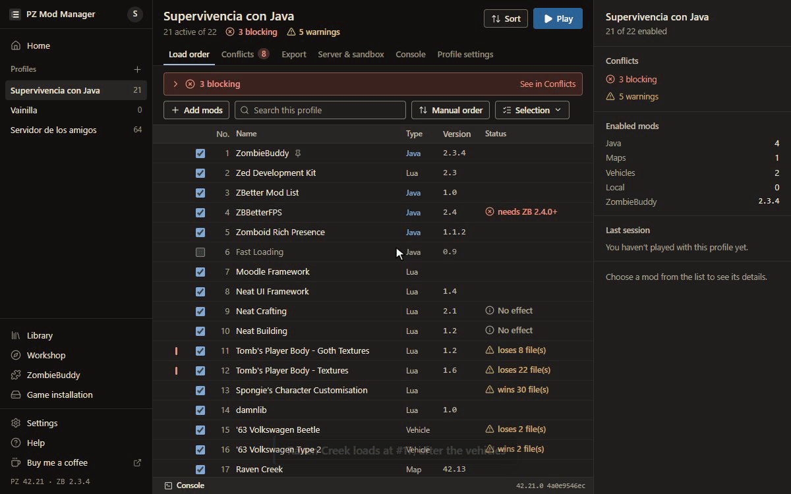
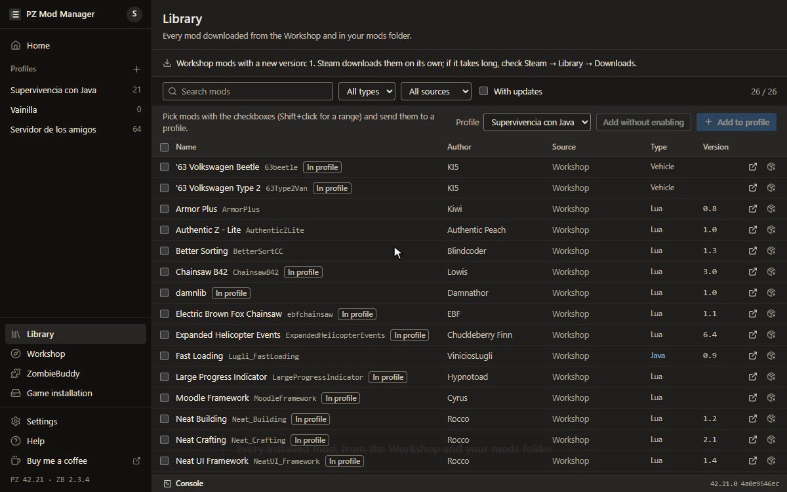
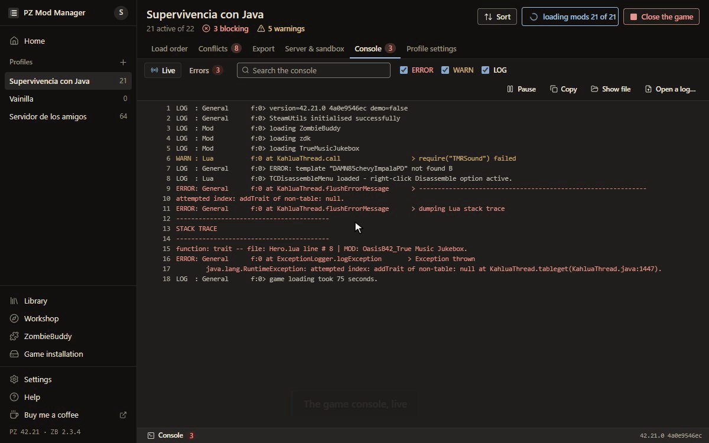
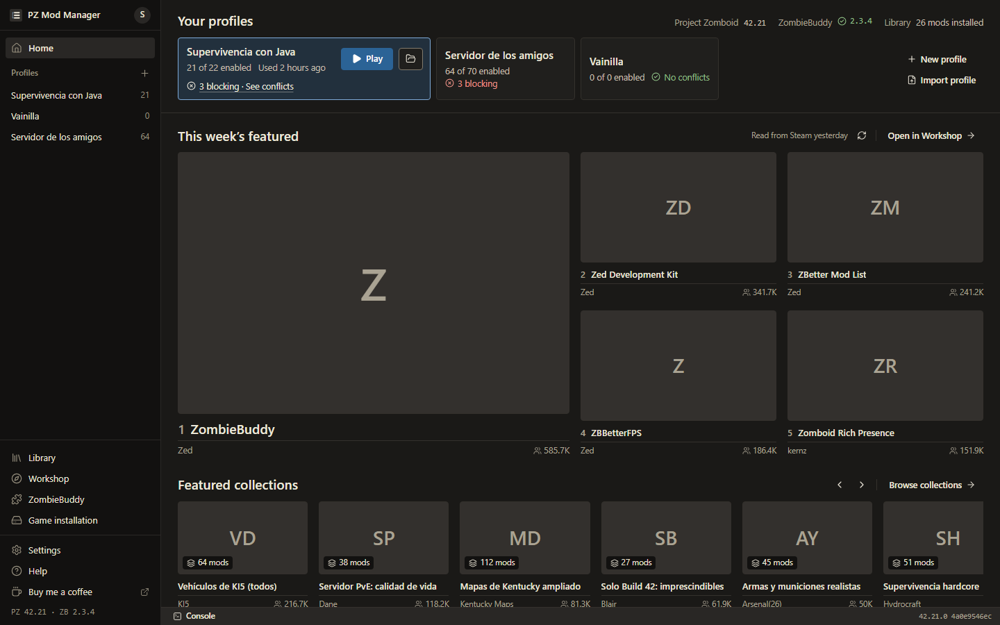
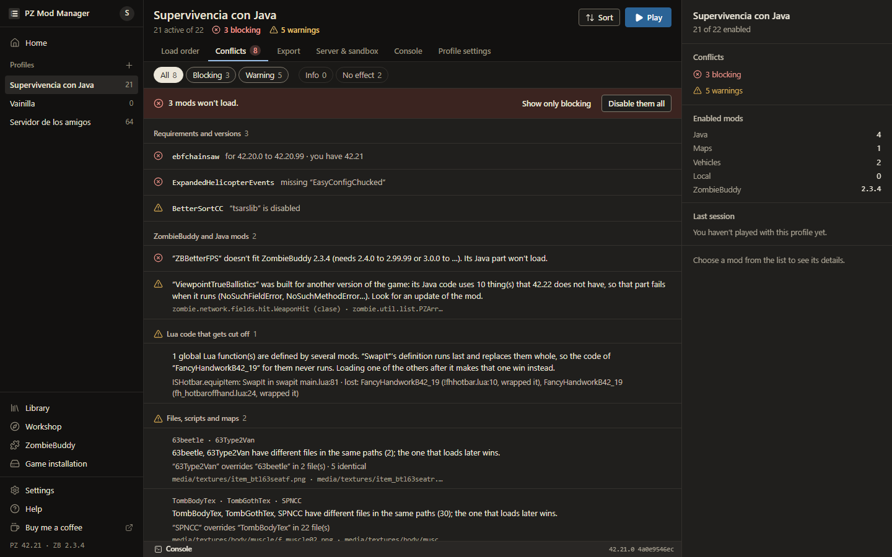
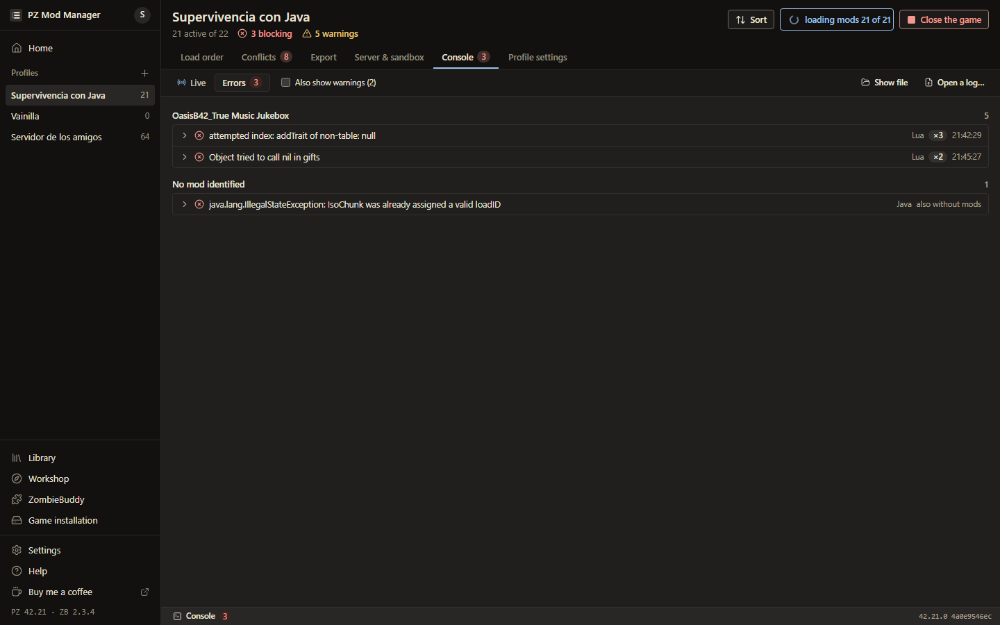
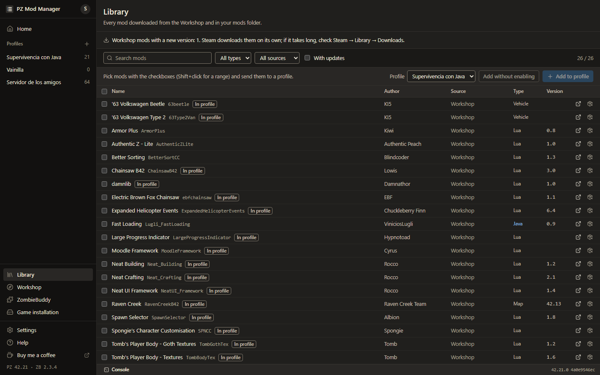
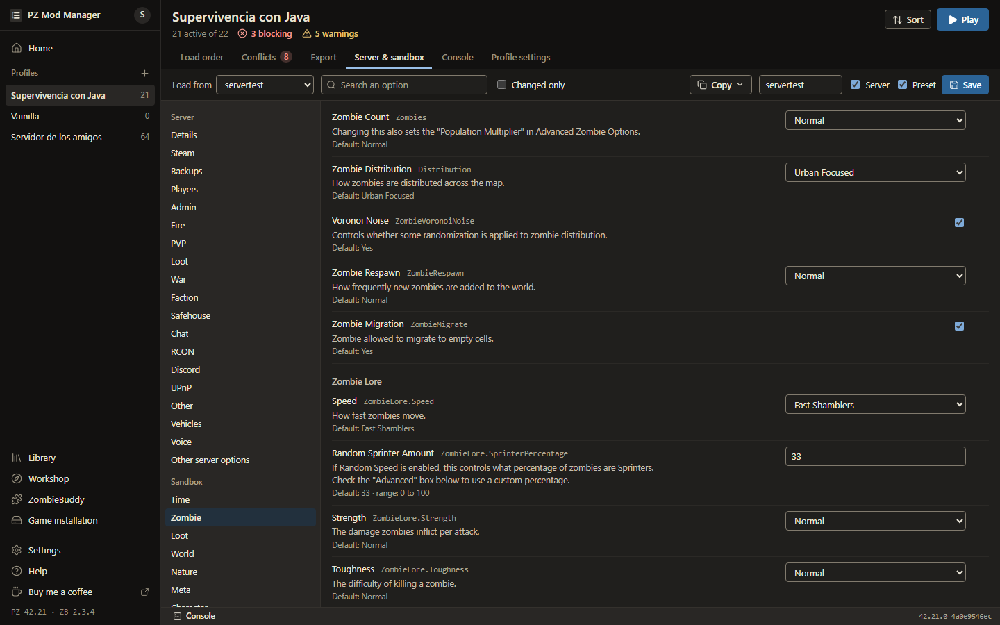
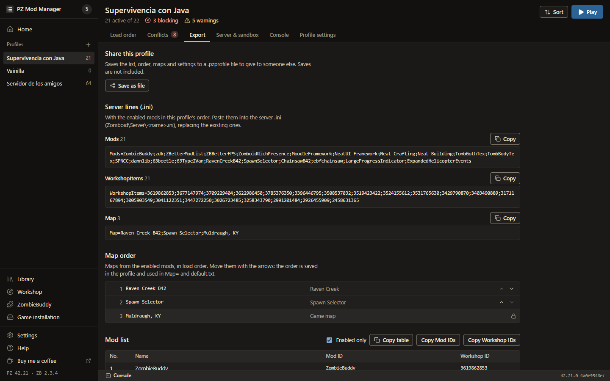

# PZ Mod Manager

[English](README.md) | Español

Gestor de mods para Project Zomboid (Build 42) en Windows. Cada perfil tiene su lista de mods, su orden de carga y su propia carpeta de partidas y opciones, y al jugar la app arranca el juego con ese perfil. También instala y actualiza ZombieBuddy para usar mods Java.

La interfaz está en español y en inglés.

## Descarga

Descarga el instalador desde [Releases](https://github.com/Ledezma28-1/pz-mod-launcher/releases/latest). La app también tiene [página en el Workshop de Steam](https://steamcommunity.com/sharedfiles/filedetails/?id=3840658470); suscribirse no añade nada al juego.

Cada instalador lo compila [GitHub Actions](.github/workflows/release.yml) a partir del código etiquetado de este repositorio, no el PC de nadie. Las notas de la versión traen su SHA-256, y GitHub firma un registro de dónde se compiló, que puedes comprobar con [GitHub CLI](https://cli.github.com):

```bash
gh attestation verify PZ.Mod.Manager_0.3.0_x64-setup.exe --repo Ledezma28-1/pz-mod-launcher
```

[Informe de VirusTotal de la v0.1.0](https://www.virustotal.com/gui/file/ce47540fafe8558b1a718a4bd1cec76fddf5c78f9b91287d96c80678ddf47890): 2 de 69 motores lo marcan (Arctic Wolf y SecureAge, los dos de aprendizaje automático). Son falsos positivos habituales en instaladores sin firmar; Microsoft Defender, Kaspersky, ESET, BitDefender y los demás no encuentran nada.

## En acción

| | |
|---|---|
|  |  |
| Ordenar la carga. Cada movimiento dice por qué. | Arreglar un conflicto desde la lista. |
|  |  |
| Añadir mods instalados a un perfil. | Leer los errores del juego, agrupados por mod. |

## Capturas

| | |
|---|---|
|  |  |
| Inicio: tus perfiles y los mods destacados de la semana | Conflictos, agrupados por tema |
|  |  |
| Errores de la consola del juego, agrupados por mod | Biblioteca: todos los mods instalados, listos para añadir a un perfil |
|  |  |
| Opciones de servidor y sandbox, del juego y de tus mods | Líneas `Mods=`, `WorkshopItems=` y `Map=` para el `.ini` de un servidor |

Los GIF y las capturas usan datos de ejemplo y están en inglés.

## Qué hace

- Perfiles aislados: cada uno usa su carpeta con `-cachedir`, así que las partidas, las opciones y la lista de mods de un perfil no se mezclan con las de otro ni con las del juego.
- Orden de carga calculado con las mismas reglas que lee el juego (`require`, `loadModAfter`, `loadModBefore`), con orden automático y orden manual.
- Detección de conflictos: requisitos que faltan, mods de otra versión del juego o de Build 41, mods incompatibles, IDs repetidos, ciclos de requisitos, archivos que un mod pisa a otro, funciones Lua que se anulan entre mods y parches Java que tocan los mismos métodos.
- ZombieBuddy: lo instala, lo actualiza y lo desinstala, con copia de seguridad de lo que cambia en la carpeta del juego.
- Workshop dentro de la app: buscar mods y colecciones, suscribirse y añadirlos a un perfil.
- Consola del juego en vivo, resumen de por qué falló una partida y búsqueda por mitades del mod que la rompe.
- Editor de opciones de servidor y de sandbox, y las líneas `Mods=`, `WorkshopItems=` y `Map=` listas para copiar en un `.ini`.
- Compartir un perfil en un archivo `.pzprofile` e importarlo en otro PC.

## Qué toca en tu PC

La app necesita hacer cosas que pueden llamar la atención en un antivirus o en una revisión de código. Esto es todo lo que hace fuera de su propia carpeta:

- Carpeta del juego: solo la cambia cuando instalas, actualizas o desinstalas ZombieBuddy desde la app. Antes guarda una copia de cada archivo con su SHA-256 para poder restaurarlo. ZombieBuddy funciona añadiendo `-agentlib:zbNative` a `ProjectZomboid64.json` y `ProjectZomboid64.bat`; la app hace ese cambio y lo deshace al desinstalar.
- Steam: para el Workshop carga el `steam_api64.dll` que trae el juego y se identifica como Project Zomboid (App ID 108600). Mientras tienes abierta la pantalla del Workshop, Steam te muestra jugando a Project Zomboid. La sesión se cierra antes de lanzar el juego.
- Datos de Steam: lee, sin modificarlos, `loginusers.vdf`, `localconfig.vdf` y la caché de avatares para mostrar tu nombre, tu foto y tus horas de juego. También lee el registro de Windows para encontrar dónde está instalado Steam.
- Archivos propios: los perfiles van en `%USERPROFILE%\PZModManager\perfiles` y los ajustes, cachés y registros en `%APPDATA%\PZModManager`.
- Red: habla con Steam (a través del cliente de Steam abierto), descarga las imágenes de las fichas del Workshop desde donde estén alojadas y, al abrirse, pregunta a GitHub cuál es la última versión de este repositorio para avisarte si hay una nueva (se puede desactivar en Ajustes). Nunca descarga ni instala nada por su cuenta. No tiene telemetría ni servidores propios.

El instalador no está firmado con un certificado de Windows, así que SmartScreen avisará de que el editor es desconocido.

## Requisitos

- Windows 11 (no está probada en otras versiones). Puede haber versión para Linux y macOS si alguien ayuda a adaptarla: lo que depende de Windows (Steam, ZombieBuddy, el arranque del juego y los enlaces de carpetas y la ventana de WebView2) está en unos pocos módulos de `core/src` y en `src-tauri/src/lib.rs`, y se aceptan pull requests.
- Project Zomboid Build 42 instalado desde Steam.

## Compilar

Hace falta [Rust](https://rustup.rs) estable, Node.js 22.12 o posterior y las herramientas de compilación de C++ de Visual Studio.

```bash
npm ci
npx tauri dev
```

Para generar el instalador:

```bash
npx tauri build
```

El instalador queda en `target/release/bundle/nsis/`.

## Créditos

ZombieBuddy es de [zed-0xff](https://github.com/zed-0xff/ZombieBuddy). Este proyecto no tiene relación con The Indie Stone ni con el autor de ZombieBuddy.

Si la app te resulta útil, puedes [invitarme a un café](https://buymeacoffee.com/ledezzma).

## Licencia

MIT. Ver [LICENSE](LICENSE).
