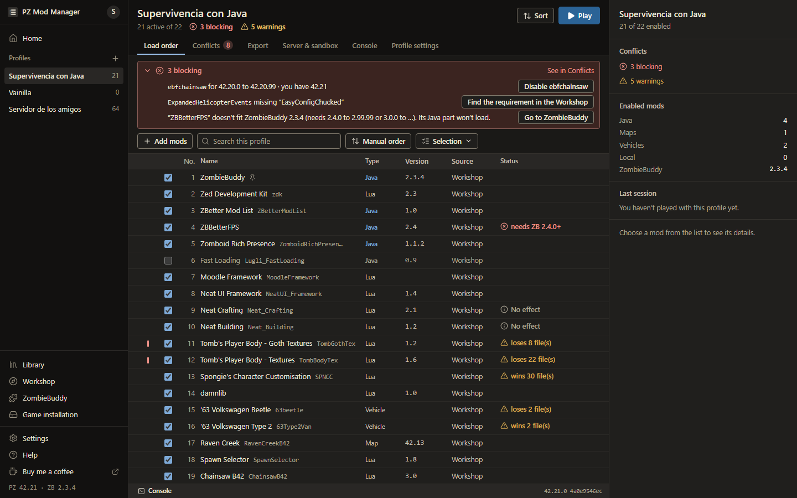
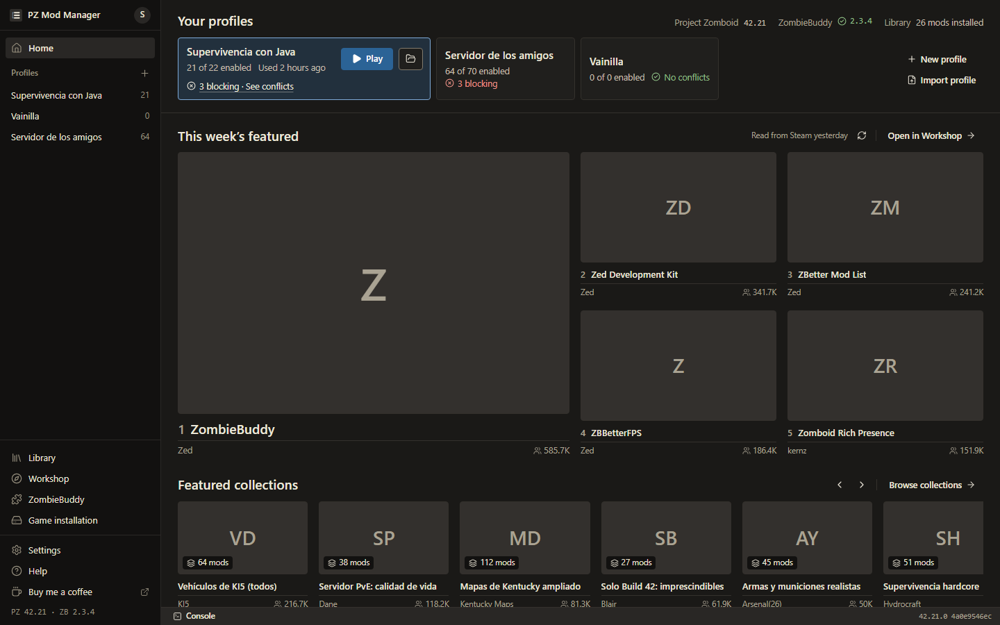
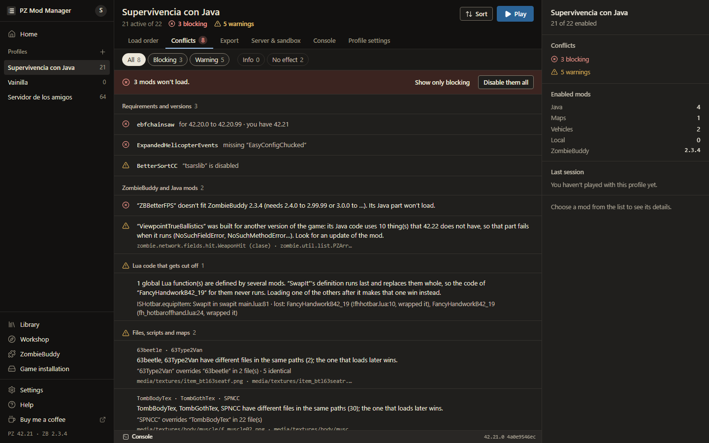
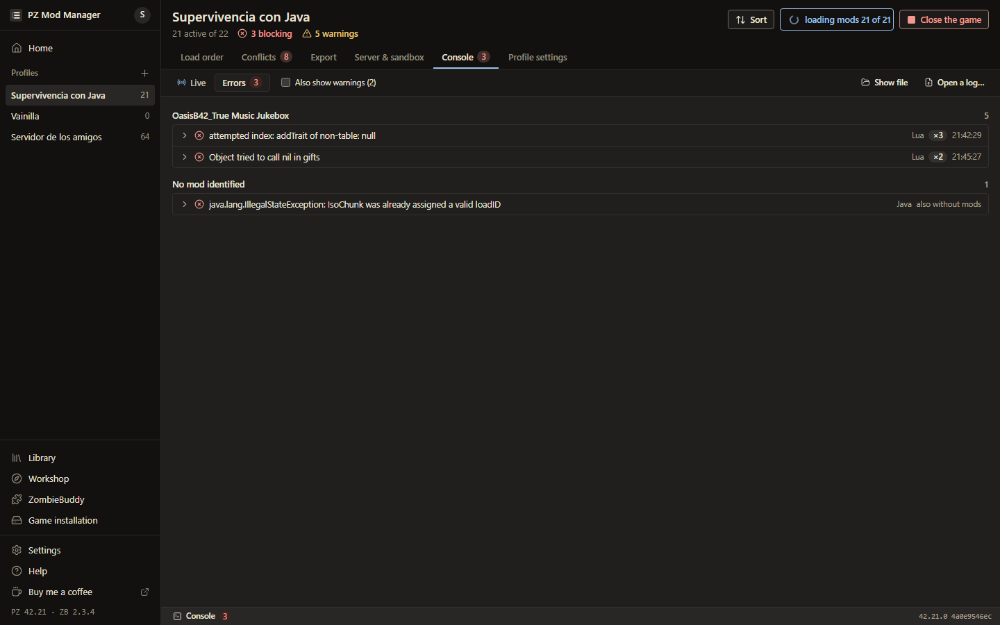
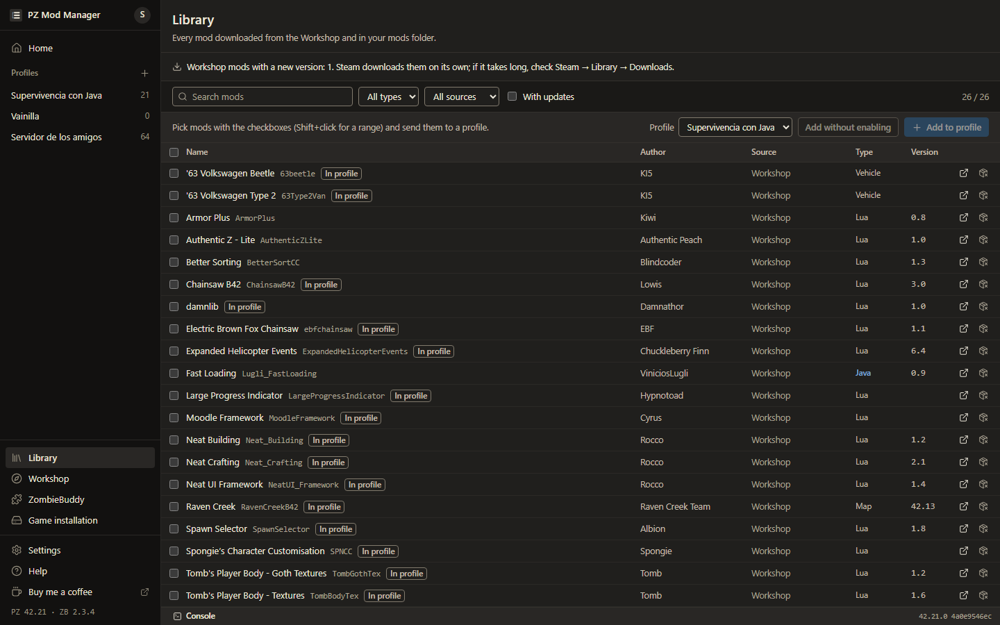
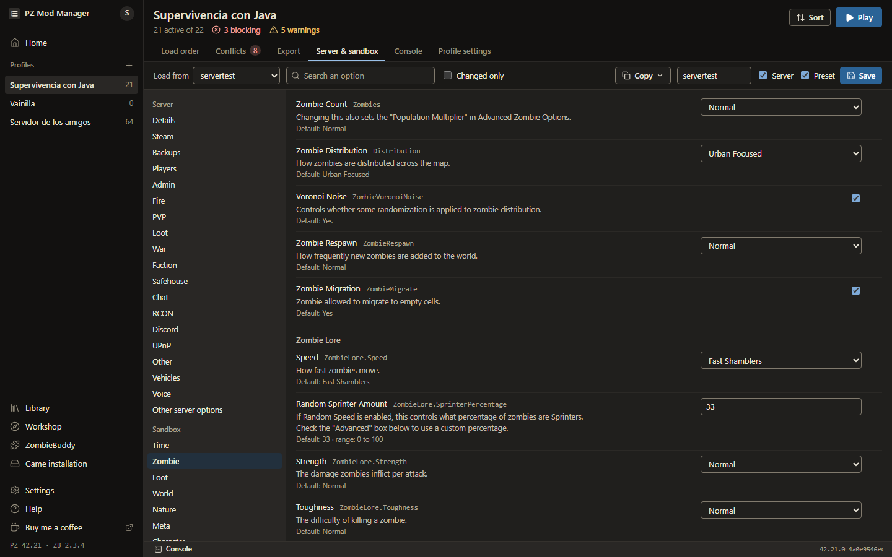
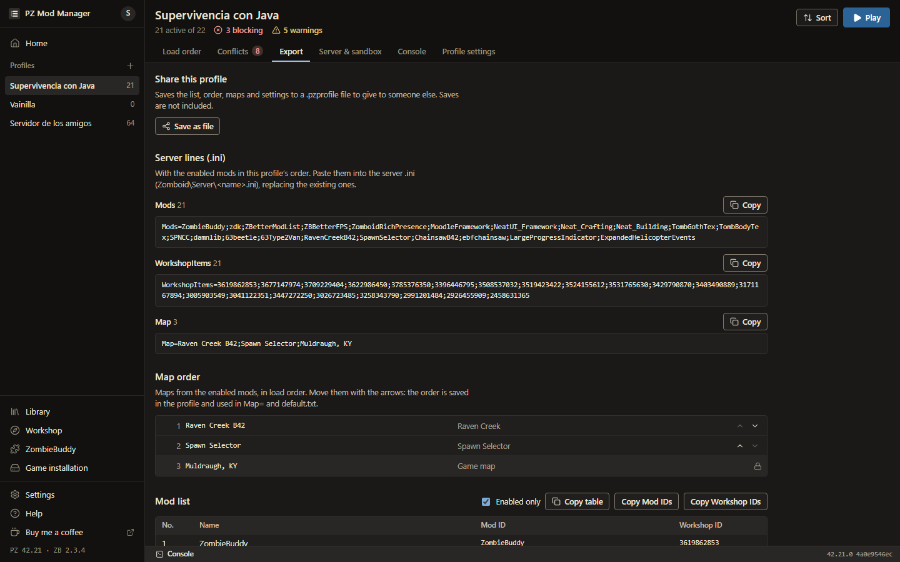

# PZ Mod Manager

English | [Español](README.es.md)

A mod manager for Project Zomboid (Build 42) on Windows. Each profile has its own mod list, load order, and folder for saves and options, and when you play, the app launches the game with that profile. It also installs and updates ZombieBuddy so you can use Java mods.

The interface is available in English and Spanish.



## Download

Get the installer from [Releases](https://github.com/Ledezma28-1/pz-mod-launcher/releases/latest).

Each installer is built by [GitHub Actions](.github/workflows/release.yml) from the tagged source in this repository, not on someone's PC. The release notes list its SHA-256, and GitHub signs a record of where it was built, which you can check with the [GitHub CLI](https://cli.github.com):

```bash
gh attestation verify PZ.Mod.Manager_0.1.0_x64-setup.exe --repo Ledezma28-1/pz-mod-launcher
```

## Screenshots

| | |
|---|---|
|  |  |
| Home: your profiles and this week's featured mods | Conflicts, grouped by topic |
|  |  |
| Game console errors, grouped by mod | Library: every installed mod, ready to add to a profile |
|  |  |
| Server and sandbox options, from the game and your mods | `Mods=`, `WorkshopItems=` and `Map=` lines for a server `.ini` |

The screenshots use sample data.

## Features

- Isolated profiles: each one uses its own folder through `-cachedir`, so a profile's saves, options and mod list never mix with another profile's or with the game's own.
- Load order built from the same rules the game reads (`require`, `loadModAfter`, `loadModBefore`), with automatic and manual ordering.
- Conflict detection: missing requirements, mods for another game version or for Build 41, incompatible mods, duplicate IDs, requirement cycles, files one mod overrides in another, Lua functions that mods overwrite in each other, and Java patches on the same methods.
- ZombieBuddy: install, update and uninstall it, with a backup of whatever changes in the game folder.
- The Workshop inside the app: search mods and collections, subscribe, and add them to a profile.
- A live view of the game console, a summary of why a session failed, and a search that splits the mod list in halves to find the mod that breaks it.
- An editor for server and sandbox options, and the `Mods=`, `WorkshopItems=` and `Map=` lines ready to paste into an `.ini`.
- Sharing a profile as a `.pzprofile` file and importing it on another PC.

## What it touches on your PC

The app has to do some things that an antivirus or a code review may flag. This is everything it does outside its own folders:

- Game folder: it only changes it when you install, update or uninstall ZombieBuddy from the app. Before that it saves a copy of each file with its SHA-256 so it can be restored. ZombieBuddy works by adding `-agentlib:zbNative` to `ProjectZomboid64.json` and `ProjectZomboid64.bat`; the app makes that change and reverts it when you uninstall.
- Steam: for the Workshop it loads the `steam_api64.dll` that ships with the game and identifies itself as Project Zomboid (App ID 108600). While the Workshop screen is open, Steam shows you as playing Project Zomboid. The session is closed before the game is launched.
- Steam data: it reads, without changing them, `loginusers.vdf`, `localconfig.vdf` and the avatar cache to show your name, picture and hours played. It also reads the Windows registry to find where Steam is installed.
- Its own files: profiles go in `%USERPROFILE%\PZModManager\perfiles`, and settings, caches and logs in `%APPDATA%\PZModManager`.
- Network: it only talks to Steam (through the running Steam client) and loads Workshop page images from wherever they are hosted. There is no telemetry and no server of its own.

The installer is not signed with a Windows certificate, so SmartScreen will warn that the publisher is unknown.

## Requirements

- Windows 11 (not tested on other versions).
- Project Zomboid Build 42 installed through Steam.

## Building

You need stable [Rust](https://rustup.rs), Node.js 22.12 or later, and the Visual Studio C++ build tools.

```bash
npm ci
npx tauri dev
```

To build the installer:

```bash
npx tauri build
```

The installer ends up in `target/release/bundle/nsis/`.

## Credits

ZombieBuddy is made by [zed-0xff](https://github.com/zed-0xff/ZombieBuddy). This project is not affiliated with The Indie Stone or with the author of ZombieBuddy.

If you find the app useful, you can [buy me a coffee](https://buymeacoffee.com/ledezzma).

## License

MIT. See [LICENSE](LICENSE).
